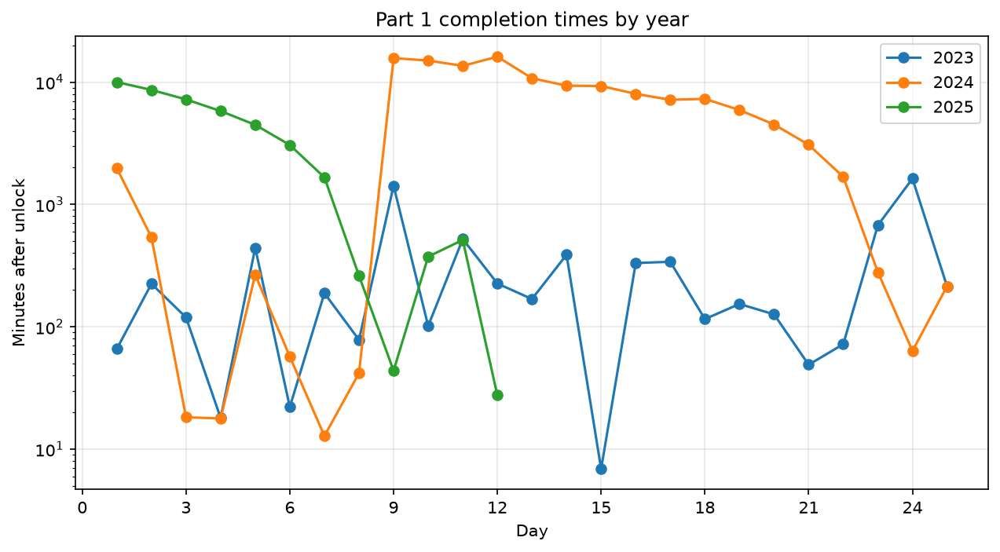
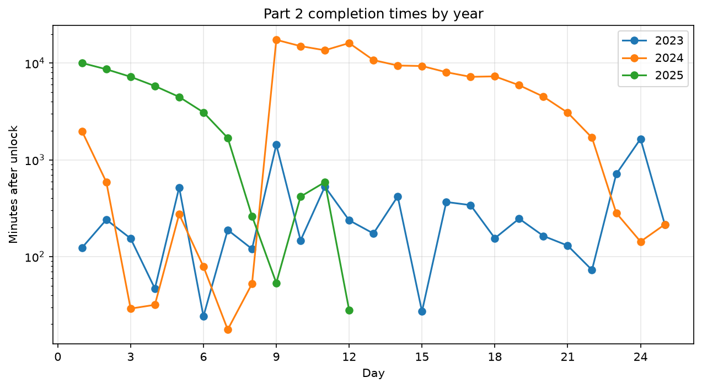

# Advent of Code
My solutions for [Advent of Code](https://adventofcode.com), created by the wonderful [Eric Wastl](https://was.tl/).

# Progress by Year
<!-- progress -->
  
  
  

<!-- /progress -->
